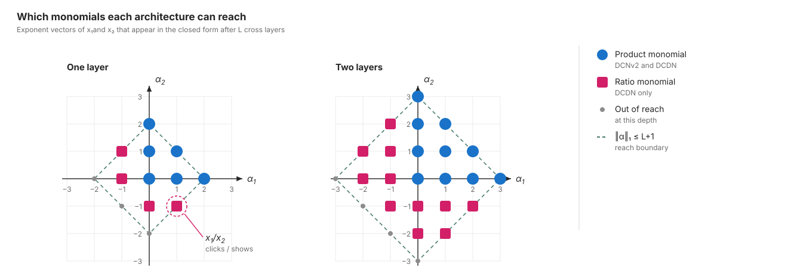

<div align="center">

# DCDN — Deep Division Network

**A cross network with a masked reciprocal branch, so that a ratio of historical
counters is one weight instead of an approximation.**

<!-- ─────────────  fill these in before release  ───────────── -->

### _{{PAPER_TITLE}}_

{{AUTHOR_1}}<sup>1</sup> · {{AUTHOR_2}}<sup>1</sup> · {{AUTHOR_3}}<sup>2</sup>

<sup>1</sup>{{AFFILIATION_1}} · <sup>2</sup>{{AFFILIATION_2}}

[]({{PAPER_URL}})
[]({{ARXIV_URL}})
[](https://www.python.org)
[](https://pytorch.org)

<!-- ────────────────────────────────────────────────────────── -->

</div>

---

## Abstract

> {{ABSTRACT}}
>
> _Placeholder. The paragraph below is the working summary this branch was
> assembled around; replace it with the camera-ready abstract._

Production rankers spend a large share of their feature inventory on **manually
engineered ratios of historical counters** — click-through rates, average watch
times, per-impression engagement. A DCNv2-style cross layer computes
`x_{i+1} = x_0 ⊙ W x_i + x_i`, so every coordinate is a polynomial in the inputs
with non-negative exponents; the quotient `n/d` is outside that span and can only
be approximated locally. **DCDN** adds one term,

```
x_{i+1} = x_i + x_0 ⊙ W_p(x_i) + inv(x_0) ⊙ W_d(x_i)
```

where `inv(x_0)` inverts only the coordinates a frozen contract declares to be
legitimate positive denominators. The span becomes Laurent, the exponent `−1`
becomes reachable by gradient descent, and a ratio `x_j / x_i` becomes a single
learned weight.

We evaluate on four public datasets and one production feed, against thirteen
baselines including two architectures — AFN+ and EulerNet — that also have
division in their hypothesis class. We report where the mechanism pays, where it
does not, and what it costs to serve.

---

## What is in this branch

This is the **pre-release subset**: the model code the published numbers were
produced with, the Triton inference kernel, the two result documents, and a
notebook that verifies the division primitive end to end. The full research tree —
data acquisition, materialization contracts, every intermediate study — lives on
[`experiments/wsdm27`]({{REPO_URL}}/tree/experiments/wsdm27).

```
├── README.md
├── dcdn_synthetic_and_explainability.ipynb   ← start here, runs in ~1 minute
├── kernel/dcdn_fused_triton.py               ← the fused inference kernel
├── docs/
│   ├── rq1_addenda.md                        ← does DCDN learn division?
│   └── rq2_rq3.md                            ← reduced-input quality, serving cost
├── figures/fused_kernel.svg
├── src/dcdn/                                 ← 18 modules, 185 KB
└── scripts/                                  ← training, benchmarking, reporting
```

---

## Install

```bash
python -m venv .venv && source .venv/bin/activate
pip install -r requirements.txt
export PYTHONPATH="$PWD/src:$PYTHONPATH"
export DCDN_DATA_CACHE="$HOME/.cache/dcdn"      # where materialized views live
```

Measured on **NVIDIA A100-SXM4-80GB**, CUDA 12.8, cuDNN 9.10.02, PyTorch
2.8.0+cu128, Triton 3.4.0, Python 3.12.3. The Triton kernel needs a CUDA device;
everything else runs on CPU, slowly.

---

## Research questions

### RQ1 · Does DCDN learn division, or a surface that resembles it?

A synthetic multi-quotient task with a known closed form, four evaluation slices
frozen before any run, and nine architectures at matched capacity. Loss is MSE
over target variance, so **1.0 is exactly the constant predictor**.

**Result.** Trained across four decades of operand range, DCDN reaches **~1e-06 on
every slice** — 8x better than AFN+, 60x better than the capacity-matched DCNv2
and 1,900x better than DCNv2. The same arms trained on one decade put DCDN at
**16,830** on the rescaled slice: the training range, not the architecture,
decides whether the quotient is learned. Confirmed narrowly — every slice in that
result lies inside the training range, so it is not evidence of extrapolation.

📄 **[`docs/rq1_addenda.md`](docs/rq1_addenda.md)**

```bash
python scripts/run_synthetic_train_distribution.py --device cuda:0
```

No download required — the task is generated.

---

### RQ2 · Can a reduced-input model recover the removed ratios?

REDUCED withholds every manually engineered quotient while keeping each numerator
and each denominator. Four datasets, fourteen architectures, eight seeds each.

**Result — negative on three of four.** A reduced-input arm reaches the
full-input field only on KuaiRec, and there the arm that does it is
`eulernet_reduced`, not DCDN. `dcdn_reduced` ranks 13th, 6th, 7th and 13th of
fourteen.

📄 **[`docs/rq2_rq3.md`](docs/rq2_rq3.md)**

```bash
python scripts/run_kuairand_single_target.py --device cuda:0 \
    --target watch_ratio_gt2 --preconditioner none \
    --views "$DCDN_DATA_CACHE/runtime/kuairec_watch_time_v1" \
    --annex-seeds --save-predictions --field \
    --output-dir results/kuairec_watch_time/binary_field_v1

python scripts/report_field_table.py \
    --results results/kuairec_watch_time/binary_field_v1/results_v1.json
```

> Materialized views are built by the data pipeline on `experiments/wsdm27`.
> Every contract is frozen and hash-pinned before acquisition; week 26 of
> VK-LSVD is sealed and never fetched.

---

### RQ3 · Does DCDN buy more quality per millisecond?

Quality and cost measured on the **same configurations** — the benchmark runs the
exact arm configs the quality run trained, at the exact operand widths.

**Result — yes, on all four slices, 24 of 24 paired comparisons.** The margin is
earned on latency, not accuracy: at matched parameters and FLOPs DCDN is
**1.29x–1.46x faster** while being statistically indistinguishable on two datasets
and significantly worse on two.

📄 **[`docs/rq2_rq3.md`](docs/rq2_rq3.md)**

```bash
python scripts/benchmark_batch_sweep.py --device cuda:0 \
    --geometry kuairec_watch_time --field \
    --output-dir results/kuairec_watch_time/batch_sweep_v1

python scripts/report_overall.py        # joins quality, parameters and cost
```

---

## The fused inference kernel

`inv(x_0)` is not a free operation. The reference implementation builds the
masked reciprocal carrier, applies the validity gate, and runs two affine blocks
as separate PyTorch ops — six kernel launches where one would do.
[`kernel/dcdn_fused_triton.py`](kernel/dcdn_fused_triton.py) fuses the carrier and
the recurrence into a single Triton kernel.

<div align="center">

</div>

**Two independent wins, measured separately.**

| | speedup of the block |
|---|---|
| fused kernel | **2.1x – 2.2x**, flat across batch sizes |
| + validity check hoisted off the hot path | **2.9x – 3.0x** total |

The second one is worth naming on its own. The reference path calls
`bool(validity.all())` on every forward, which is a **device-to-host
synchronisation**: it costs 0.04–0.08 ms regardless of batch size, is 24% of the
block at `B=1`, and blocks CUDA-graph capture outright. `verify_all_valid` is a
`staticmethod` so a caller can validate a whole dataset once and then set
`validate_validity_per_call = False`.

**Numerical agreement with the reference is 5.96e-07** — one unit in the last
place of float32, on both operand widths.

```python
from dcdn.fused_inference import FusedDCDNCore

FusedDCDNCore.verify_all_valid(validity)          # once, for the whole dataset
core = FusedDCDNCore.from_core(model.interaction.core)
core.validate_validity_per_call = False           # now off the hot path
```

### Where it actually pays

The right-hand panel is the honest part. Inside a production ranker whose
attention layer costs 93% of the forward pass, the interaction block is
**0.3–0.4%** of total latency, and the kernel is worth **20% of the whole stack at
`B=1`** and **0.3% at `B=8192`**. Fuse it if you serve online at small batches;
skip it if you score offline in large ones.

---

## The synthetic notebook

**[`dcdn_synthetic_and_explainability.ipynb`](dcdn_synthetic_and_explainability.ipynb)**
— theory, a one-minute experiment, and an explainability section.

On `y = x_0 / x_1` with four distractor operands drawn log-uniformly over four
decades, DCDN reaches a normalized MSE of `1.9e-05` against `6.0e-01` for a
DCNv2-style cross of the same shape — a gap of **31,675x**.

### Both models, read back from their weights

A one-layer DCDN block with a linear head is *exactly* a Laurent polynomial, and
two cross layers with a linear head are *exactly* a cubic polynomial. Neither
needs an attribution method — the coefficients are products of learned numbers.
Both expansions are verified against their model in the notebook, to `7e-07`
relative error.

| | DCNv2 | DCDN |
|---|---|---|
| form | polynomial | **Laurent polynomial** |
| exponents | `α ≥ 0` | `α ∈ ℤ`, negative only on declared denominators |
| `x0/x1` | **not in the span** | one weight, `W_d[1,0]` |
| what it learned | 83 monomials, largest `+0.4991·x0` | **1 monomial, `+1.0003·x0/x1`** |
| normalized MSE | 0.600 | 0.0000190 |

DCDN did not approximate the quotient — it **selected** it, with a coefficient of
1.0003 and every remaining term an order of magnitude smaller. DCNv2, having no
way to write the quotient, spent 83 monomials on a smooth surface that agrees
with it where the training mass is.

<div align="center">

</div>

The lattice is generated by the notebook, not drawn by hand: it enumerates the
exponent vectors the recurrence can realise at each depth. Grey points lie inside
the degree bound and are still out of reach, because one layer can apply the
reciprocal only once.

---

## What this work does not claim

Recorded here because the results contradict the obvious reading:

- **DCDN is not the first model that can divide.** AFN+ and EulerNet both have
  division in their hypothesis class, both outrank DCDN on median quality, and
  both cost 7x–11x the latency and 12x–54x the parameters. The defensible claim
  is about **size**: no arm of DCDN's size uses division at all.
- **DCDN is not the most accurate architecture** on any dataset median, and it
  never beats its capacity-matched comparator on quality.
- **RQ2 fails on three of four public datasets.**
- **No architecture in the field is stable.** Thirteen of fourteen have both a
  top-three and a bottom-three dataset; a single-dataset verdict would have named
  four different winners.

---

## Citation

```bibtex
@inproceedings{ {{BIBTEX_KEY}} ,
  title     = { {{PAPER_TITLE}} },
  author    = { {{AUTHOR_LIST}} },
  booktitle = { {{VENUE_FULL}} },
  year      = { {{YEAR}} },
  url       = { {{PAPER_URL}} }
}
```

## License

{{LICENSE}} — see [`LICENSE`](LICENSE).
