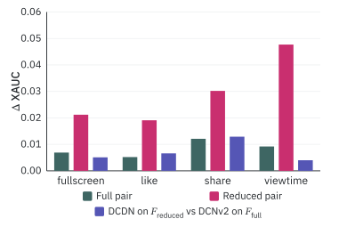
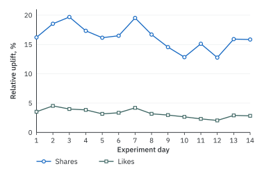
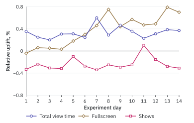
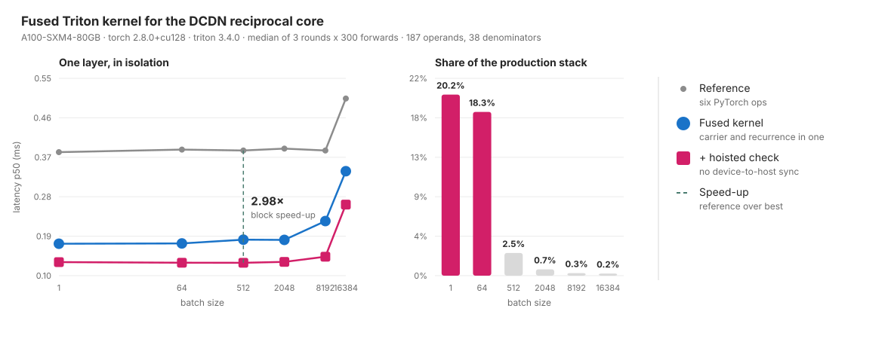

<div align="center">

# DCDN — Deep Cross-Division Network

**A cross network with a masked reciprocal branch, so that a ratio of historical
counters is one weight instead of an approximation.**

### _Deep Cross-Division Network for Product-and-Ratio Feature Interactions in Industrial Ranking_

**Anonymous Authors** · under double-blind review

[]({{PAPER_URL}})
[]({{ARXIV_URL}})
[](https://www.python.org)
[](https://pytorch.org)

</div>

---

## Abstract

Learning effective feature interactions is essential for industrial recommender
systems. DCN and DCNv2 efficiently automate polynomial feature crossing. However,
their cross layers construct interactions using only non-negative integer powers
of the input features, with the maximum degree controlled by network depth.
Consequently, they cannot directly represent the reciprocal terms required for
ratios, rates, and normalized counts unless such features are explicitly provided
as inputs.

We introduce DCDN, a Deep Cross-Division Network that augments a DCNv2-style
cross layer with a division branch. DCDN jointly learns product, ratio, and mixed
product–ratio interactions. We characterize the learned interactions using
multivariate Laurent polynomials and show that DCDN can generate Laurent
monomials of any order up to a maximum determined by network depth.

We evaluated DCDN against a production-optimized neural-ranking baseline built
around DCNv2 and supplied with manually engineered ratio features. Replacing the
DCNv2 block with DCDN allowed us to eliminate the entire class of manually
engineered ratio features from the model input, reducing the overall input
feature amount by 40.1%. DCDN is deployed in the production ranking stack of a
major short-video service. In a live A/B test on this service, DCDN increased
likes by 3.25%, shares by 16.26%, total view time by 0.33%, and clicks to open
fullscreen by 0.38%; all changes were statistically significant. The number of
short videos shown to users remained stable. These results demonstrate that DCDN
can improve user engagement while eliminating reliance on manually engineered
ratio features. Our code is publicly released at
[https://anonymous.4open.science/r/DCDN-2D6D](https://anonymous.4open.science/r/DCDN-2D6D).

---

## The operator, in one line

A DCNv2 cross layer computes `x_{i+1} = x_i + x_0 ⊙ W x_i`, so every coordinate
is a polynomial in the inputs with non-negative exponents — the quotient `n/d`
lies outside that span and can only be approximated locally. DCDN adds one term:

```
x_{i+1} = x_i + x_0 ⊙ W_p(x_i) + inv(x_0) ⊙ W_d(x_i)
```

`inv(x_0)` inverts only the coordinates a frozen contract declares to be
legitimate positive denominators. The span becomes **Laurent**, the exponent `−1`
becomes reachable by gradient descent, and a ratio `x_j / x_i` becomes a single
learned weight. A `K`-layer stack realises exactly the Laurent monomials of
signed degree `−K` through `K+1`, and both bounds are attainable.

---

## What is in this branch

This is the **pre-release subset**: the model code the published numbers were
produced with, the Triton inference kernel, the research-question documents, and
a notebook that verifies the division primitive end to end. The full research
tree — data acquisition, materialisation contracts, every intermediate study —
lives on the project's experiment branch.

```
├── README.md
├── dcdn_synthetic_and_explainability.ipynb   ← start here, runs in ~1 minute
├── kernel/dcdn_fused_triton.py               ← the fused inference kernel
├── docs/
│   ├── rq1.md                                ← quotient learning
│   ├── rq2.md                                ← ranking quality and inference efficiency
│   └── rq3.md                                ← capacity
├── figures/
├── src/dcdn/                                 ← 18 modules, 185 KB
└── scripts/                                  ← training, benchmarking, reporting
```

---

## Install

```bash
python -m venv .venv && source .venv/bin/activate
pip install -r requirements.txt
export PYTHONPATH="$PWD/src:$PYTHONPATH"
export DCDN_DATA_CACHE="$HOME/.cache/dcdn"      # where materialized views live
```

Measured on **NVIDIA A100-SXM4-80GB**, CUDA 12.8, cuDNN 9.10.02, PyTorch
2.8.0+cu128, Triton 3.4.0, Python 3.12.3. The Triton kernel needs a CUDA device;
everything else runs on CPU, slowly.

---

## Research questions

The four questions are answered in order: what the operator learns, what it is
worth on public ranking data, whether that is just capacity, and whether any of
it survives contact with a production system.

### RQ1 · Can DCDN learn ratio-like functions directly from their operands?

A synthetic task whose target `y = n1/d1` is never given as an input, four
evaluation regimes frozen before any run, and **ten architectures** with the
learning rate tuned per arm on a shared grid. Loss is MSE over target variance,
so **1.0 is exactly the constant predictor**.

> **Answer.** DCDN learns quotient-like functions directly from their operands
> with very high accuracy over the multi-scale range studied. It is **best in
> three of the four regimes** and reduces the error of DCNv2 by **two to three
> orders of magnitude** throughout — reciprocal crossing is a strong inductive
> bias for ratio-like dependencies, not merely a representability result.

| regime | DCDN | DCNv2 | factor |
|---|---|---|---|
| Reference range | **4.25e-07** | 5.47e-05 | **129×** |
| Common rescaling | 1.21e-06 | 1.96e-03 | **1,620×** |
| Large denominator | **2.81e-07** | 2.05e-04 | **729×** |
| Small denominator | **8.74e-07** | 6.03e-04 | **690×** |

**Read narrowly.** Every regime lies inside the training range, so this is not
evidence of extrapolation; on common rescaling DCDN is third, behind AutoInt+
and EulerNet; and at a one-decade benchmark it reports **16,830** on common
rescaling, where the targets are bitwise identical to the reference regime. The
branch is an effective basis for quotients inside the range it was fitted on,
not a scale-free reciprocal operator.

📄 **[`docs/rq1.md`](docs/rq1.md)**

```bash
python scripts/run_synthetic_train_distribution.py --device cuda:0 --tune \
    --only loguniform_01_1000
```

No download required — the task is generated.

---

### RQ2 · How does DCDN compare in ranking quality and measured latency?

Yambda-50M, KuaiRec, KuaiRand-Pure and VK-LSVD. Every model receives `F_full`
for the quality comparison, so no architecture is handed explicit ratio features
another is denied; latency is measured separately on `F_reduced` at batch 8192.
Eight seeds per arm, learning rate tuned per arm and then fixed.

> **Answer.** DCDN provides a favourable quality–efficiency trade-off. It
> **improves on its direct DCNv2 parent on every dataset**, on both the primary
> metric and nDCG@10, while staying in approximately the same latency regime —
> and it is **substantially cheaper to serve** than the more general AFN+ and
> EulerNet. Not universal accuracy dominance: competitive quality at a much
> lighter inference cost.

| | Yambda AUC | KuaiRec AUC | KuaiRand XAUC | VK-LSVD AUC |
|---|---|---|---|---|
| DCNv2 | 0.81989 | 0.80482 | 0.51854 | 0.71303 |
| **DCDN** | **0.82065** | **0.80774** | **0.52935** | **0.72642** |
| best of field | EulerNet 0.82190 | **DCDN** | AutoInt+ 0.55748 | **DCDN** |

| p50 latency at B=8192 | Yambda | KuaiRec | KuaiRand | VK-LSVD |
|---|---|---|---|---|
| **DCDN** | **0.622** | **0.635** | **0.713** | **0.644** |
| DCNv2 | 0.614 | 0.622 | 0.816 | 0.663 |
| AFN+ | 4.331 | 3.752 | 5.512 | 4.648 |
| EulerNet | 5.196 | 4.539 | 6.294 | 5.407 |

DCDN is best on both reported metrics for KuaiRec and VK-LSVD, mid-field on
Yambda, and beaten on KuaiRand — which is the clearest counterexample to
universal superiority. AFN+ costs **5.9×–7.7×** the DCDN latency and EulerNet
**7.1×–8.8×**.

📄 **[`docs/rq2.md`](docs/rq2.md)**

```bash
python scripts/run_kuairand_single_target.py --device cuda:0 \
    --target watch_ratio_gt2 --preconditioner none \
    --views "$DCDN_DATA_CACHE/runtime/kuairec_watch_time_v1" \
    --annex-seeds --save-predictions --field \
    --output-dir results/kuairec_watch_time/binary_field_v1

python scripts/report_field_table.py \
    --results results/kuairec_watch_time/binary_field_v1/results_v1.json
```

---

### RQ3 · Is the difference just capacity?

`dcnv2_capacity_reduced` is a deeper standard DCNv2 on the **same** `F_reduced`
input, selected by search to land within ±5% of DCDN on both trainable
non-embedding parameters and FLOPs, with no metric read. Realised agreement is
±0.2%. Quality is reported as nDCG@10 so the four datasets share one scale.

> **Answer.** The operating point is **not explained by parameter count alone**.
> At the same reduced input and a comparable parameter budget, DCDN achieves
> **higher nDCG@10 and lower p50 latency than the capacity-matched DCNv2 on all
> four datasets**. Deepening the original cross stack does not reproduce the
> trade-off.

| dataset | DCNv2-cm | DCDN | Δ nDCG@10 | speedup |
|---|---|---|---|---|
| Yambda | 0.7571 | **0.7590** | **+0.0019** | **1.15×** |
| KuaiRec | 0.4375 | **0.4441** | **+0.0066** | **1.15×** |
| KuaiRand | 0.6719 | **0.6765** | **+0.0046** | **1.47×** |
| VK-LSVD | 0.8521 | **0.8535** | **+0.0014** | **1.30×** |

**Read narrowly.** On the *primary* metric rather than nDCG@10, the same paired
comparison is significantly worse on two datasets and indistinguishable on two —
DCDN is better at the top of the ranking and not better at global pairwise
separation. The latency column is the part that holds under every metric.

📄 **[`docs/rq3.md`](docs/rq3.md)**

```bash
python scripts/benchmark_batch_sweep.py --device cuda:0 \
    --geometry kuairec_watch_time --field \
    --output-dir results/kuairec_watch_time/batch_sweep_v1

python scripts/report_overall.py        # joins quality, parameters and cost
```

---

### RQ4 · Production

The public experiments isolate the interaction block under controlled
conditions. RQ4 asks whether the same trade-off survives in a deployed system,
as a **local intervention** rather than a redesign: in a multi-head short-video
ranker, the single DCNv2 layer is replaced by a single DCDN layer, the
engineered ratio/rate family is deleted from the feature pipeline, and
everything downstream — Hiformer, the sequential user model, the task towers,
calibration and utility fusion — is held fixed.

> **Answer.** The quality–efficiency advantage **transfers**. Against the
> full-feature DCNv2 control, the reduced-feature DCDN treatment improves offline
> XAUC on **all four production objectives** and yields statistically significant
> online gains in the main engagement metrics, while removing **40.1%** of the
> input features. Model-computation time falls **42.4%** and end-to-end
> ranking-service time **10.5%**.

**Offline gate.** Session-level XAUC on production validation data, four
variants: both architectures under `F_full` and both under `F_reduced`. The
deployed pair is **DCNv2 full (control) vs DCDN reduced (treatment)**; the other
two comparisons separate the feature-view effect from the architecture effect.

| objective | DCNv2 full | DCDN full | DCNv2 reduced | DCDN reduced | full pair | reduced pair | **production pair** |
|---|---|---|---|---|---|---|---|
| Fullscreen | 0.6238 | 0.6307 | 0.6077 | 0.6289 | +0.0069 | +0.0212 | **+0.0051** |
| Like | 0.7325 | 0.7377 | 0.7200 | 0.7391 | +0.0052 | +0.0191 | **+0.0066** |
| Share | 0.5805 | 0.5926 | 0.5632 | 0.5934 | +0.0121 | +0.0302 | **+0.0129** |
| View time | 0.5589 | 0.5681 | 0.5152 | 0.5629 | +0.0092 | +0.0477 | **+0.0040** |

<div align="center">

</div>

The reduced pair is the load-bearing column. Deleting the engineered ratios
costs DCNv2 between **0.0125 and 0.0437** XAUC across the four heads; it costs
DCDN at most **0.0052**, and on like and share the reduced model is marginally
*ahead* of its own full-view version (+0.0014 and +0.0008). DCDN absorbs nearly
all of the damage, which is what makes deleting the family affordable at all —
and the treatment then stays ahead of the production control on every objective
while seeing 40.1% fewer inputs.

**Online A/B, 14 days, production traffic.**

| metric | change |
|---|---|
| Likes | **+3.25%** |
| Shares | **+16.26%** |
| Total view time | **+0.33%** |
| Fullscreen opens | **+0.38%** |
| Shows | −0.24% |

<div align="center">


</div>

Likes, shares and total view time are positive on **all 14 days**, fullscreen on
13 of 14. Shows move −0.24%, which is treated as no material change in exposure:
the number of short videos put in front of users stays stable while engagement
per exposure rises.

**Serving.** The ranker is served with Triton Inference Server at dynamic batch
sizes from 1 to 16,384, at tens of thousands of ranking requests per second.

| quantity | change |
|---|---|
| Number of input features | **−40.1%** |
| Model-computation time | **−42.4%** |
| Ranking-service time | **−10.5%** |

The end-to-end reduction is smaller than the model-side one because model
application is only about 20% of the recommendation response time. These are
properties of the **deployed package** — the treatment changes the interaction
block *and* the feature path, and realised latency also depends on batching and
fused kernels. It is not a claim that a reciprocal operation is intrinsically
cheaper than a standard cross.

---

## The fused inference kernel

`inv(x_0)` is not a free operation. The reference implementation builds the
masked reciprocal carrier, applies the validity gate, and runs two affine blocks
as separate PyTorch ops — six kernel launches where one would do.
[`kernel/dcdn_fused_triton.py`](kernel/dcdn_fused_triton.py) fuses the carrier and
the recurrence into a single Triton kernel.

<div align="center">

</div>

**Two independent wins, measured separately.**

| | speedup of the block |
|---|---|
| fused kernel | **2.1× – 2.2×**, flat across batch sizes |
| + validity check hoisted off the hot path | **2.9× – 3.0×** total |

The second one is worth naming on its own. The reference path calls
`bool(validity.all())` on every forward, which is a **device-to-host
synchronisation**: it costs 0.04–0.08 ms regardless of batch size, is 24% of the
block at `B=1`, and blocks CUDA-graph capture outright. `verify_all_valid` is a
`staticmethod` so a caller can validate a whole dataset once and then set
`validate_validity_per_call = False`.

**Numerical agreement with the reference is 5.96e-07** — one unit in the last
place of float32, on both operand widths.

```python
from dcdn.fused_inference import FusedDCDNCore

FusedDCDNCore.verify_all_valid(validity)          # once, for the whole dataset
core = FusedDCDNCore.from_core(model.interaction.core)
core.validate_validity_per_call = False           # now off the hot path
```

### Where it actually pays

The right-hand panel is the honest part. Inside a production ranker whose
attention layer costs 93% of the forward pass, the interaction block is
**0.3–0.4%** of total latency, and the kernel is worth **20% of the whole stack at
`B=1`** and **0.3% at `B=8192`**. Fuse it if you serve online at small batches;
skip it if you score offline in large ones. In the deployed stack of RQ4 the same
fusion is roughly **2×** over eager DCDN, alongside a feature-encoding kernel
that is roughly **7×** over its eager counterpart.

---

## The synthetic notebook

**[`dcdn_synthetic_and_explainability.ipynb`](dcdn_synthetic_and_explainability.ipynb)**
— theory, a one-minute experiment, and an explainability section.

On `y = x_0 / x_1` with four distractor operands drawn log-uniformly over four
decades, DCDN reaches a normalized MSE of `1.9e-05` against `6.0e-01` for a
DCNv2-style cross of the same shape — a gap of **31,675×**.

### Both models, read back from their weights

A one-layer DCDN block with a linear head is *exactly* a Laurent polynomial, and
two cross layers with a linear head are *exactly* a cubic polynomial. Neither
needs an attribution method — the coefficients are products of learned numbers.
Both expansions are verified against their model in the notebook, to `7e-07`
relative error.

| | DCNv2 | DCDN |
|---|---|---|
| form | polynomial | **Laurent polynomial** |
| exponents | `α ≥ 0` | `α ∈ ℤ`, negative only on declared denominators |
| `x0/x1` | **not in the span** | one weight, `W_d[1,0]` |
| what it learned | 83 monomials, largest `+0.4991·x0` | **1 monomial, `+1.0003·x0/x1`** |
| normalized MSE | 0.600 | 0.0000190 |

DCDN did not approximate the quotient — it **selected** it, with a coefficient of
1.0003 and every remaining term an order of magnitude smaller. DCNv2, having no
way to write the quotient, spent 83 monomials on a smooth surface that agrees
with it where the training mass is.

<div align="center">

</div>

The lattice is generated by the notebook, not drawn by hand: it enumerates the
exponent vectors the recurrence can realise at each depth. Grey points lie inside
the degree bound and are still out of reach, because one layer can apply the
reciprocal only once.

---

## What this work does not claim

Recorded here because each one contradicts an obvious reading of the results
above:

- **DCDN is not the first model that can divide.** AFN+ and EulerNet both have
  division in their hypothesis class, both outrank DCDN on median quality across
  the full metric set, and both cost **7×–11× the latency** and **12×–54× the
  parameters**. The defensible claim is about **size**: no arm of DCDN's size
  uses division at all.
- **DCDN is not a universal accuracy winner.** It is best on both reported
  metrics for KuaiRec and VK-LSVD, mid-field on Yambda, and beaten on KuaiRand by
  AutoInt+ on XAUC and by EulerNet on nDCG@10. The consistent claim is against
  its direct DCNv2 parent, which it beats on all four.
- **At matched capacity the win is metric-dependent.** DCDN takes nDCG@10 on all
  four datasets and loses or ties the primary metric on all four. Only the
  latency margin is metric-independent.
- **Deleting ratio features is not free on public data.** A reduced-input arm
  reaches the best full-input arm on one dataset of four, and there the arm that
  does it is EulerNet, not DCDN. The 40.1% removal in RQ4 works because that
  ratio family is large and redundant with the operands that stay — it is not a
  general result about ratio removal.
- **No architecture in the field is stable.** Thirteen of fourteen arms have both
  a top-three and a bottom-three dataset; a single-dataset verdict would have
  named four different winners.

---

## Citation

```bibtex
@inproceedings{ {{BIBTEX_KEY}} ,
  title     = {Deep Cross-Division Network for Product-and-Ratio
               Feature Interactions in Industrial Ranking},
  author    = { {{AUTHOR_LIST}} },
  booktitle = { {{VENUE_FULL}} },
  year      = { {{YEAR}} },
  url       = { {{PAPER_URL}} }
}
```

## License

{{LICENSE}} — see [`LICENSE`](LICENSE).
