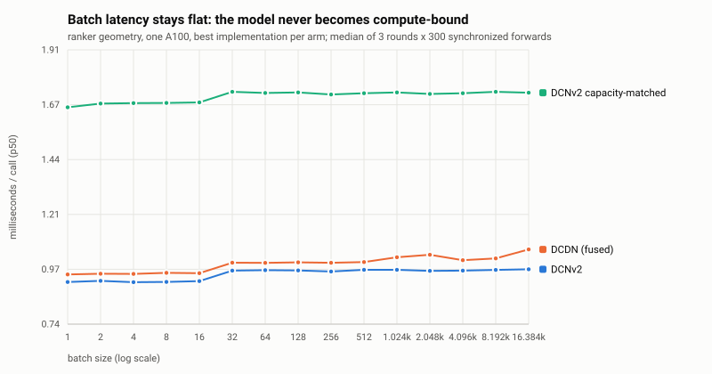
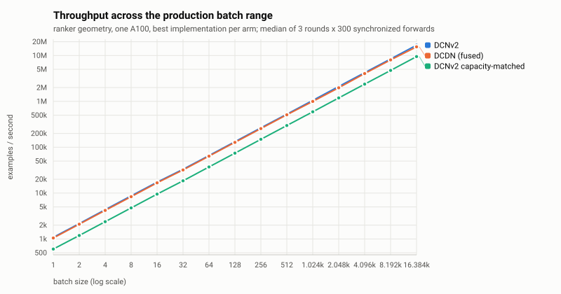
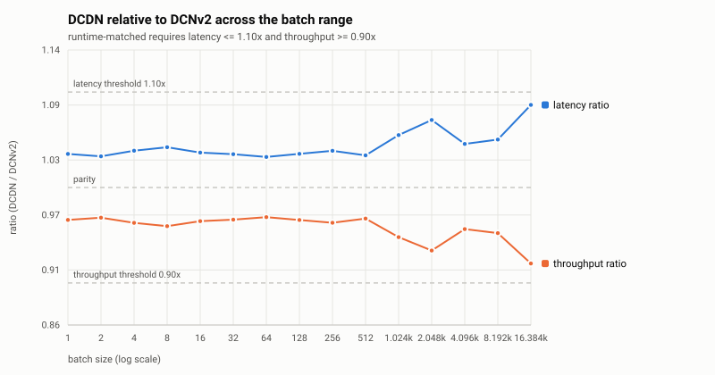

# RQ2 addendum — serving cost across the production batch range

Artifact role: `rq2_batch_sweep_result`. Status: **complete**.
Artifacts: `results/efficiency/rq2_batch_sweep_v1/` — `results_v1.json`
(`2fd8aa9f…`), `batch_sweep.csv` (75 rows, `4cc54f99…`), pre-measurement
manifest published before the first timed forward. All verify against strict
exact-byte sidecars. Figures: `docs/figures/batch-sweep-*.svg` (light and dark).

## 1. Why `B=1` was not enough

The frozen protocol fixes its runtime-matched threshold at `p95(B=1)`, and the
two earlier studies reported that point. But production serves with dynamic
batching over roughly `1..16000`, and `B=1` is the *worst* operating point for
this particular comparison: one row per call is pure fixed overhead, so a
measurement there cannot show whether DCDN's 2.2x lower interaction FLOPs
eventually pay. A single point is not a serving-cost answer.

This sweep measures 15 batch sizes from 1 to 16384 under each arm's best
available implementation (DCDN fused, DCNv2 reference), with a declared lighter
protocol — 50 warmups, 300 synchronized forwards, 3 rounds per point — since
its job is to trace a shape, not to re-decide the frozen threshold.

Two regimes were expected, with a crossover between them worth locating:
launch-bound at small `B`, work-bound at large `B`.

## 2. The headline: there is no crossover

**Latency is essentially flat across the entire range.**

| arm | B=1 | B=64 | B=1024 | B=4096 | B=16384 | growth |
|---|---:|---:|---:|---:|---:|---:|
| DCNv2-REDUCED | 0.920 | 0.971 | 0.972 | 0.969 | 0.974 | **+6%** |
| DCDN-REDUCED (fused) | 0.952 | 1.002 | 1.025 | 1.013 | 1.059 | **+11%** |
| DCNv2-capacity-matched | 1.662 | 1.723 | 1.726 | 1.722 | 1.725 | +4% |

Milliseconds per call, p50. A **16,384-fold increase in work costs 6–11% more
time.** The second regime never arrives: on an A100 this model class stays
dispatch-bound across the whole production batch range.

Throughput therefore scales almost linearly, from ~1,000/s at `B=1` to ~16.8M/s
at `B=16384` — the curve is set by amortising a fixed ~0.95 ms call over more
rows, not by the models doing arithmetic faster.





## 3. The ratio is stable, and the margin narrows slightly

| B | latency ratio | throughput ratio |
|---:|---:|---:|
| 1 | 1.035 | 0.966 |
| 8 | 1.042 | 0.960 |
| 64 | 1.032 | 0.969 |
| 512 | 1.034 | 0.967 |
| 1024 | 1.055 | 0.948 |
| 2048 | 1.071 | 0.934 |
| 4096 | 1.046 | 0.956 |
| 8192 | 1.050 | 0.952 |
| **16384** | **1.086** | **0.920** |

DCDN stays **inside the runtime-matched band at every batch size measured** —
latency never exceeds the 1.10x threshold, throughput never drops below 0.90x.
But the margin *narrows* at the top of the range rather than widening: from
1.035/0.966 at `B=1` to 1.086/0.920 at `B=16384`. At `B=16384` DCDN sits within
1.3% of the latency threshold and 2.2% of the throughput threshold.



## 4. Why the FLOP advantage never materialises

DCDN carries 6.6x fewer interaction parameters and 2.2x fewer FLOPs than DCNv2
at ranker width. None of that shows up, because **arithmetic is never the
bottleneck**. At `B=16384` the adapter alone is ~165 MFLOP, which an A100 at
~19.5 TFLOP/s fp32 retires in well under 0.01 ms — against a ~0.95 ms call.
The models are two to three orders of magnitude away from saturating the
device.

CUDA-event device time confirms this is real GPU-timeline behaviour and not
host measurement overhead: the wall-over-device ratio is **1.01 at every point**
for both arms, and device latency for DCNv2 moves only 0.907 → 0.961 ms across
the full sweep. The ~0.95 ms is dispatch and inter-kernel gaps on the stream,
not compute.

The practical consequence: **the remaining lever is dispatch elimination, not
further FLOP reduction.** CUDA Graphs, or fusing across the encoder/tower
boundary rather than only inside the interaction block, is where the next
factor lives. Reducing DCDN's arithmetic further would change nothing
measurable at these widths.

The slight degradation at the top of the range is consistent with this: at
`B=16384` DCDN's extra carrier tensor and wider intermediates finally add
enough memory traffic to be visible, which is a bandwidth effect rather than an
arithmetic one.

## 5. The capacity-matched control at scale

`M4` was matched to DCDN within 0.1% on parameters *and* FLOPs, yet it costs
1.72 ms per call at every batch size and delivers **9.5M/s against DCDN's
15.5M/s at `B=16384`** — 39% less throughput. Its low-rank mixture runs a
gating softmax and an expert loop, which is many small kernels regardless of
how few FLOPs they represent.

This is the sweep's second independent demonstration that parameter/FLOP
matching and runtime matching are different checks, and it is stronger than the
single-point version: the gap holds across four orders of magnitude in batch
size.

## 6. What this changes

**Strengthens.** The runtime-parity claim for DCDN versus DCNv2 no longer rests
on one operating point. It holds across `1..16384`, which is the production
range, under each architecture's best implementation.

**Qualifies.** The claim must be stated with its margin: parity is comfortable
below `B≈1024` and thin at `B=16384` (1.086 against 1.10). A deployment that
batches aggressively at the top of the range should re-measure on its own
hardware rather than inherit this verdict.

**Refutes a plausible expectation.** One might expect DCDN's lower FLOP count to
turn into a throughput *win* at large batch. It does not, anywhere in the
production range, on this hardware. Publishing that expectation as a prediction
would have been wrong.

**Unchanged.** No quality number is involved. RQ2 as a whole still needs
recommendation-dataset quality, which this does not supply.

## 7. Reproduction

```bash
cd deep_division_network
source scripts/env.sh
PY="$UV_PROJECT_ENVIRONMENT/bin/python"
"$PY" scripts/benchmark_batch_sweep.py --device cuda:0 --allow-busy-host
"$PY" scripts/plot_batch_sweep.py
```

The plotter emits self-contained SVG with no plotting dependency — the pinned
`uv.lock` environment is not perturbed for a chart. Figures are written for
both light and dark surfaces from the same palette steps.
