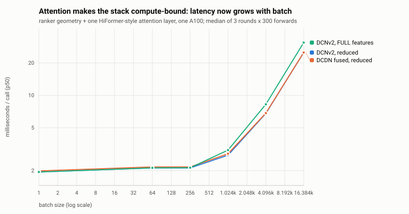
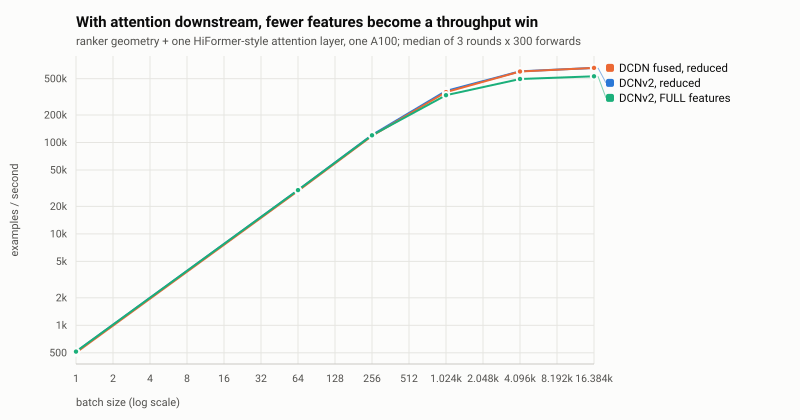
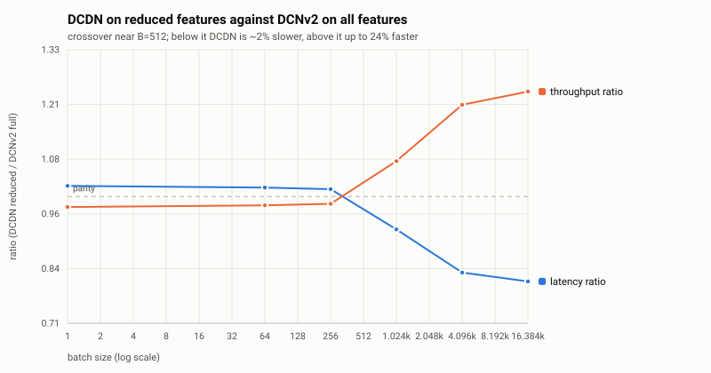

# RQ2 addendum — cost with a HiFormer-style layer after the cross

Artifact role: `rq2_hiformer_stack_result`. Status: **complete**.
Artifacts: `results/efficiency/rq2_hiformer_v1/` — `results_v1.json`
(`f91b3a2c…`), `hiformer_stack.csv` (24 rows, `2ba66c08…`), pre-measurement
manifest (`7d9259c2…`) published before the first timed forward. All verify
against strict exact-byte sidecars. Figures: `docs/figures/hiformer-*.svg`.

**Scope, stated first.** This is a **cost** study. The HiFormer-style layer is
outside the frozen nine-model suite, nothing is trained, and no quality number
is produced or implied. It also is not a faithful reproduction of the published
HiFormer; it implements the property that decides the cost question —
heterogeneous per-group projections over field tokens with `O(F²d)` attention.

## 1. What the cross-only studies could not show

Three earlier studies agreed on two things: DCDN and DCNv2 reach runtime parity,
and the reduced feature view buys nothing at inference — appending the 17
`R_div` columns changed latency by 0.2–1%. Both follow from the same cause. A
cross layer costs roughly linearly in width, so dropping 17 of 78 operands
saves little, and on an A100 the whole stack stays dispatch-bound anyway, so
arithmetic differences never surface.

A production ranker rarely stops at the cross. The moment a component whose cost
grows **superlinearly in the field count** sits downstream, the feature
reduction stops being cosmetic. Self-attention is exactly that component:

| regime | field tokens (incl. cross token) | attention FLOPs/example |
|---|---:|---:|
| REDUCED | 68 | 295,936 |
| FULL | 85 | 462,400 |
| ratio | 1.25× | **1.562×** |

## 2. The stack

Identical across arms except the interaction block and the feature regime:

```
encoder → field tokens [B, F, 16] and flat [B, 96 + operands]
cross(flat) → crossed
cross token = Linear(flat → 16)
HiFormer-style heterogeneous attention over [categorical | cross token | operands]
flatten → tower → 4 per-target heads
```

DCDN arms use the fused Triton core established in `docs/rq2_fused_inference.md`;
DCNv2 uses its reference implementation, which was faster for it.

| arm | tokens | interaction params | non-embedding params |
|---|---:|---:|---:|
| DCNv2, reduced | 68 | 49,612 | 126,992 |
| **DCDN fused, reduced** | 68 | **7,564** | **84,944** |
| DCNv2, FULL | 85 | 60,900 | 156,504 |
| DCDN fused, FULL | 85 | 12,324 | 107,928 |

## 3. Attention changes the regime

The cross-only stack was dispatch-bound everywhere: a 16,384-fold work increase
cost 6–11% more time. With one attention layer the stack becomes genuinely
compute-bound.

| B | DCNv2 reduced | DCDN reduced | DCNv2 FULL | DCDN FULL |
|---:|---:|---:|---:|---:|
| 1 | 1.945 | 1.991 | 1.944 | 1.984 |
| 64 | 2.122 | 2.167 | 2.124 | 2.163 |
| 256 | 2.119 | 2.166 | 2.131 | 2.163 |
| 1024 | 2.786 | 2.873 | 3.102 | 3.150 |
| 4096 | 6.794 | 6.844 | 8.260 | 8.304 |
| 16384 | 24.983 | 24.976 | **30.891** | 30.878 |

Latency p50, ms. Throughput saturates near 656k/s on the reduced view and
530k/s on the full view, instead of scaling to 16.8M/s as it did without
attention.





## 4. Result: the hypothesis holds, with a crossover

DCDN on the **reduced** view against DCNv2 on the **full** view:

| B | latency ratio | throughput ratio | who wins |
|---:|---:|---:|---|
| 1 | 1.024 | 0.976 | DCNv2 full, by 2% |
| 64 | 1.020 | 0.980 | DCNv2 full, by 2% |
| 256 | 1.017 | 0.984 | DCNv2 full, by 2% |
| 1024 | **0.926** | **1.080** | **DCDN reduced, by 8%** |
| 4096 | **0.829** | **1.207** | **DCDN reduced, by 21%** |
| 16384 | **0.809** | **1.237** | **DCDN reduced, by 24%** |

**The crossover sits between B=256 and B=1024.** Below it the launch-bound
regime still rules and DCDN's slightly heavier block costs ~2%. Above it the
`O(F²)` attention term dominates, the 17 removed columns stop being free, and
DCDN-REDUCED pulls ahead — reaching 24% more throughput and 19% lower latency at
B=16384.



Peak VRAM at B=16384 moves the same way: **3,286 MB** on the reduced view
against **4,811 MB** on the full view, a 1.46× reduction that is pure
consequence of carrying 17 fewer tokens through attention.

## 5. Two controls that keep the reading honest

**Same features, different cross.** At matched token count DCDN and DCNv2 are
indistinguishable once attention dominates: 24.976 vs 24.983 ms at B=16384
(ratio 1.000). So the win above is **not** the reciprocal branch being faster —
it is the feature reduction, which the reciprocal branch is what makes
affordable in quality terms.

**Same cross, different features.** DCDN-FULL costs 30.878 ms against
DCDN-REDUCED's 24.976 ms — the same 1.24× penalty DCNv2 pays. The effect
is entirely attributable to token count, identically for both architectures.

Together these say: with attention downstream, **what matters is how many
features reach it**, and the architecture only matters insofar as it lets you
send fewer.

## 6. What may and may not be claimed

**May.** With one attention layer after the cross, at batches at or above ~1024,
DCDN on the reduced feature view serves at lower latency, higher throughput,
and 1.46× lower peak VRAM than DCNv2 on the full feature view. The advantage
grows with batch and reaches 24% throughput at B=16384.

**May not.** That this is *superiority over DCNv2 on all features* in any sense
beyond cost. Quality under this stack is unmeasured: nothing here was trained.
The nearest quality evidence is contrast M2−M5 on the cross-only stack, where
**DCNv2-FULL was better in-distribution by 2.84×** with clean seed separation,
and DCDN-REDUCED won only under operand-scale shift. A cost win plus an
in-distribution quality loss is a trade-off, not a dominance claim.

Establishing the full claim needs both configurations trained under this stack
and compared on quality at matched cost. That is a training study on
recommendation data, which remains the outstanding gap.

**Also note.** The crossover position depends on the downstream component. This
measured one attention layer at `d=16` with 4 heads. A wider or deeper attention
stack moves the crossover left and enlarges the advantage; a stack without any
superlinear component removes it entirely, which is what the cross-only studies
found.

## 7. Reproduction

```bash
cd deep_division_network
source scripts/env.sh
PY="$UV_PROJECT_ENVIRONMENT/bin/python"
"$PY" scripts/benchmark_hiformer_stack.py --device cuda:0 --allow-busy-host
```

Validity: worst wall-over-device p50 agreement across all 24 points was
**1.007**, so the timings are device behaviour rather than host overhead.
